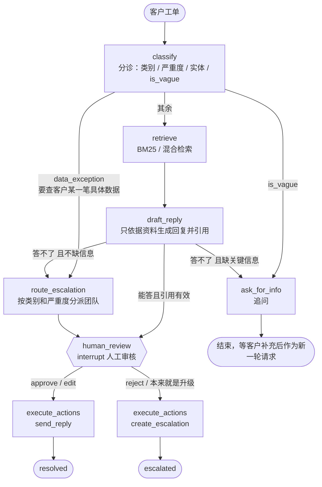

# CarePilot 架构

## 工作流

路由全部在 `src/carepilot/graph/routing.py`，建图（`build.py`）和评估运行器（`evaluation/runners.py`）共用同一份，避免评估的流程和线上悄悄分叉。

## 分层

| 层 | 位置 | 说明 |
|---|---|---|
| API | `src/carepilot/api/app.py` | FastAPI。`create_app()` 工厂，依赖可注入；同步和 SSE 流式两种响应 |
| 工作流 | `src/carepilot/graph/` | LangGraph。状态、节点、路由、建图；`SqliteSaver` 做 checkpoint，所以进程重启后还能恢复等待审核的工单 |
| 检索 | `src/carepilot/retrieval/` | 统一的 `Retriever` 协议；BM25（倒排索引）、向量、RRF 混合、重排；`factory.build_retriever(kind, ...)` 按配置组装 |
| 知识库清洗 | `src/carepilot/ingest/` | 纯规则、确定性、不调用 LLM；输出 `manifest.jsonl` + 清洗后的文档 |
| 评估 | `src/carepilot/evaluation/` + `eval/` | 评估集生成、检索/分诊/回复指标、分组汇总、A/B 脚本 |
| 工具 | `src/carepilot/tools.py` | Mock 的工单/店铺系统，节点只依赖它的方法签名，换成真实系统不用动工作流 |

## 几个刻意的设计决定

**1. 引用必须"可校验"，且校验在代码里做。**
回复节点只能依据检索到的资料回答，`cited_ids` 必须能还原成检索结果里真实存在的 chunk，还原不了就升级给人，不放行。给模型看 `[1]~[4]` 的短编号而不是 `企业版/采购入库单#1` 这种长路径：实测模型会把长路径缩写成 `资料#1`、`#0` 甚至留空，把 38% 的可答样本误杀。

**2. 缺槽位不是检索前的硬门槛。**
最初的设计是"分类后缺必填字段就追问"，但槽位抽取本身不可靠（`feature_name` 抽取准确率只有 0.63），导致 20% 本可回答的工单被拦下追问。改成两层：分诊模型对"消息笼统到判断不出要查什么"做语义判断（`is_vague`）→ 检索前追问；其余先尝试回答，答不了且确实缺信息才追问。

**3. 需要查客户具体数据的工单不检索、不生成，直接升级。**
「帮我查下这笔订单」知识库回答不了，让模型硬答只会编。分诊已经能把这一类识别出来，直接升级，同时省掉最贵的一次回复调用。

**4. 人工审核是 `interrupt`，不是回调。**
等待审核的状态落在 SQLite checkpoint 里，审核接口用 `Command(resume=...)` 恢复。`interrupt` 之前的节点代码不能有副作用（恢复时节点会从头重跑），所有对外动作都在 `execute_actions`。

**5. 评估集的标签是机械生成的，所以评估必须分层、分拆。**
评估集由知识库文档反向合成。类别标签由文档所在目录决定，不交给 LLM；检索指标不算不可答样本（它们没有标准答案，混进去会把所有命中率压低约 15%）；调参只在 dev 半边做，在 test 半边报告。

## 检索策略

| `RETRIEVER_KIND` | 说明 |
|---|---|
| `bm25`（默认） | jieba 分词 + 领域词典 + 标题加权，倒排索引，单次查询 <1 ms，无额外依赖 |
| `vector` | 本地 `bge-small-zh-v1.5`（fastembed），numpy 暴力检索 |
| `hybrid` | BM25 + 向量，RRF 融合，向量权重 0.25，每篇文档最多 2 个 chunk |
| `hybrid_rerank_ce` | 混合 + `bge-reranker-base` 交叉编码器重排（本机 CPU 约 5 秒/次） |
| `hybrid_rerank_llm` | 混合 + LLM 列表式打分重排 |

启用向量检索需要先建索引（约 20 分钟，2.2 万个 chunk）：
`uv run python scripts/build_index.py --kb-dir data/kb_real --out data/index/kb_real`，
并设置 `RETRIEVER_KIND=hybrid`；模型从 HuggingFace 下载，国内需 `HF_ENDPOINT=https://hf-mirror.com`。
